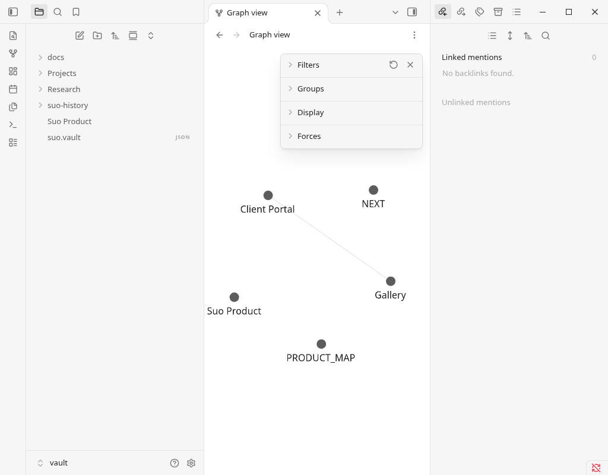
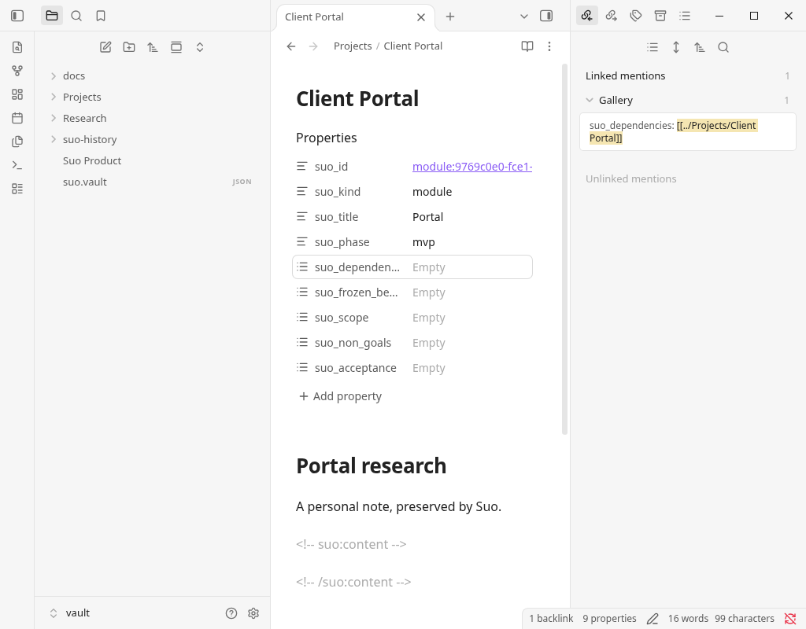
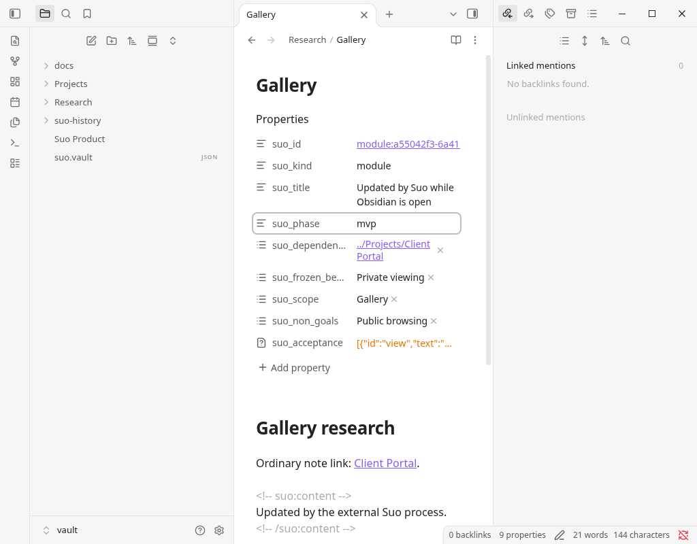

# Real Obsidian desktop compatibility test

Date: 2026-10-16 (UTC). Result: the tested Vault workflows pass in the real Linux desktop application. This is application-level evidence, not a mock of Obsidian or just filesystem unit tests.

## Environment and method

- Debian 13, Linux x86_64; a real Xorg server using its dummy display driver.
- Official Obsidian **1.14.4** AppImage, Electron **43.7.7**, Chromium **150.0.7871.250**.
- Release: https://github.com/obsidianmd/obsidian-releases/releases/tag/v1.14.4
- AppImage SHA-256: `6362ddbeeeebb7bbccb48fae009572cf2284ef92f5c919c1332aba48de6ffeaa`, matching the official release asset digest.
- Isolated synthetic Vault and application profile. Core plugins only; `alwaysUpdateLinks: true`. No private notes or user account.
- Playwright connects to the actual Electron renderer over localhost CDP. Property editing and property-link navigation use real DOM controls. File rename/move and text editing use Obsidian's native `fileManager` and editor APIs in that renderer. Backlinks, cache and graph assertions inspect the running app's own data. Suo runs separately through its CLI.
- The application was launched with `--no-sandbox --disable-gpu` for this isolated cloud test. This does not test production sandboxing or hardware-accelerated rendering.

Harness development initially encountered a Map/object mismatch, a changed graph selector, a cyclic return value, JavaScript escaping, and transient metadata-cache invalidation. These were harness issues, not Suo fixes. After correcting the harness and waiting for actual autosave, the portable scripts completed sequentially on a fresh profile and Vault without manual intervention. No Suo runtime change was needed for the tested cases.

## Observed results

| Scenario | Result |
| --- | --- |
| Click a generated `[[./Portal]]` dependency in native Properties | Opens the intended note |
| Native backlinks | Includes the typed frontmatter relationship |
| Native graph | Shows Gallery → Client Portal, including after the ordinary body link is removed |
| Edit `suo_title` through native Properties | Suo reports a draft and accepts the reviewed change |
| Rename Portal to Client Portal through Obsidian | App updates both links; Suo retains node identity and reports no authored change |
| Move Gallery into another folder through Obsidian | Relationship still resolves; Suo reports no authored change |
| Edit the managed content with the native editor | After autosave, Suo reads the new objective |
| Change a property after obtaining a review digest | Suo rejects the old digest as stale |
| Suo approves a proposal while the note is open | The app's metadata and open editor refresh to the externally written content |
| Edit a simple property alongside nested acceptance data | Structured acceptance objects are preserved |
| Change ordinary prose outside the managed region | No Product approval is needed |
| Final validation | `suo check` passes and `suo vault diff` reports no pending authored change |

Raw observations: [main results](results.json), [property-only graph and preservation results](extra-results.json).

## Screenshots

The graph screenshot is taken after the native force-layout animation settles. The body link has been removed: the remaining edge is produced by `suo_dependencies` alone.







## Confirmed limitations

1. **Nested fields are not native forms.** `suo_acceptance` is shown as structured JSON in Properties, not as editable criterion rows. Its data survives edits to neighboring properties, but editing complex data still needs source mode or an eventual UI plugin.
2. **Autosave is asynchronous.** A visible editor change is not immediately on disk. Save the note before asking the CLI/Skill to review it. The harness waits for actual disk persistence; waiting for editor text alone produced a misleading unchanged draft during harness development.
3. Native graph links represent connectivity, not Suo's relation types or approval semantics. Generated overview notes are currently isolated graph nodes unless linked separately.
4. This covers one Linux/Obsidian version with core plugins and automatic link updating enabled. macOS/Windows, third-party plugins, Sync, multi-device conflicts, crash/power-loss recovery, and truly simultaneous writes during an unsaved editor buffer were not tested. The stale-review check is not evidence of universal concurrent-write safety.

## Reproduce

Prerequisites: built Suo (`pnpm build`), Node, Python with Playwright, the official Obsidian Linux application, and a working display (physical or virtual). CDP uses the app's own Chromium; no separate Playwright browser download is needed.

Choose a **new disposable directory**, not a personal Vault. The scripts intentionally create and modify synthetic notes.

```bash
export SUO_OBSIDIAN_TEST_DIR=/tmp/suo-obsidian-test
export SUO_OBSIDIAN_CDP=http://127.0.0.1:9222
node test/manual/obsidian-setup.mjs
```

If using Xorg's dummy driver, the supplied `test/manual/obsidian-xorg.conf` can be used to start a virtual display in a separate terminal:

```bash
Xorg :99 -config "$PWD/test/manual/obsidian-xorg.conf" \
  -logfile "$SUO_OBSIDIAN_TEST_DIR/xorg.log" -noreset -nolisten tcp
```

Launch the real application with the generated profile (keep it running):

```bash
DISPLAY=:99 /path/to/extracted/obsidian \
  --no-sandbox --disable-gpu \
  --user-data-dir="$SUO_OBSIDIAN_TEST_DIR/profile" \
  --remote-debugging-address=127.0.0.1 --remote-debugging-port=9222
```

Run the scripts in sequence:

```bash
python test/manual/obsidian-desktop.py
python test/manual/obsidian-graph.py
```

They write JSON results and PNG screenshots into the disposable directory. They use some internal renderer APIs and CSS selectors, so a future Obsidian version may require harness updates. These tests are intentionally separate from `pnpm check` and do not silently install or start a desktop application in the unit suite.
